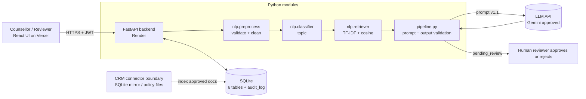

# Architecture and workflow

**Connector boundary:** policies enter only through `backend/indexer.py` from files in `data/policies`
(a mirror/export). The app never reads or writes a production CRM or LMS.

**Statuses:** query = received / answered / abstained / api_error / rejected;
answer = pending_review / approved / rejected. Every step writes `audit_log`.

**Trace for one question:** `staff_queries` (topic, confidence) -> `retrieved_passages` (rank, score) ->
`answers` (provider, model, latency, citations, prompt_version) -> `audit_log`.
